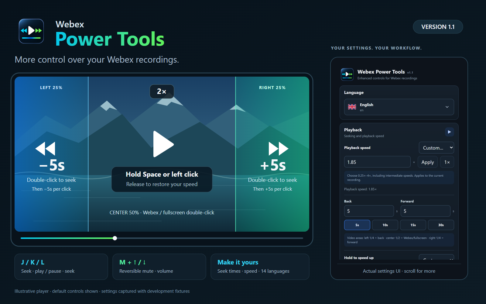

# Webex Power Tools

**More control over your Webex recordings.**

Hold to speed up, skip with mouse gestures, and control playback and audio with keyboard shortcuts. A lightweight Chrome extension with configurable controls, on-screen feedback, and 14 interface languages.



**Version 1.1** · Chrome 127+ · Manifest V3 · No build step

[Download v1.1.0][github-release] · [Chrome Web Store][chrome-web-store] · [User guide](docs/USER_GUIDE.md) · [Developer guide](docs/DEVELOPMENT.md) · [Privacy](docs/PRIVACY.md)

> Chrome Web Store updates require Google's review. If the store still offers an earlier version, download v1.1.0 from GitHub and install it locally.

## Features

- **Custom playback speed:** choose a preset or enter an intermediate value from 0.25× to 4×. The selected speed stays active after closing the popup.
- **Hold to speed up:** hold Space or left click over the video to use the greater of the current speed and your hold target. Release to restore the original speed and paused/playing state.
- **Quick seeking:** double-click the left or right quarter to start seeking, then each extra click on that side adds another seek step. Right-click the video to seek backward.
- **Keyboard controls:** J/K/L for seeking and play/pause, ↑/↓ for volume, and M for reversible mute.
- **Custom settings:** independent backward/forward durations, temporary speed, volume steps, and individual feature switches.
- **On-screen indicators:** actual playback speed during holds, cumulative seek actions, volume, and mute feedback. The native Webex toolbar also shows the effective playback speed.
- **14 languages:** automatic browser-language detection, searchable language selection, and Arabic right-to-left layout.
- **Synced preferences:** settings use Chrome extension sync storage, according to your profile and sync configuration.

## Install locally

1. Download the extension ZIP from the [GitHub release][github-release] and extract it, or clone this repository.
2. In Chrome 127 or later, open `chrome://extensions`.
3. Enable **Developer mode**.
4. Select **Load unpacked** and choose the folder containing `manifest.json`.
5. Open or refresh a Webex recording on an HTTPS `webex.com` page.
6. Open **Webex Power Tools** from the toolbar or Chrome's Extensions menu. Pin it for convenient access.

No Node.js installation, package installation, or build command is needed to use the extension. When unpinned, it also displays a floating settings launcher on supported Webex pages.

After updating the local files, reload the extension in `chrome://extensions`
and refresh each open Webex recording as well. Both steps are required to load
the updated content script.

## Controls at a glance

In the extension popup, **Playback speed** offers the same presets as **Hold to
speed up**, plus **1×** and **Custom…**. Presets apply immediately. Choose Custom
to enter 0.25×–4×, such as 0.85×, 1.15× or 1.85×, then choose **Apply** or press
Enter. **1×** restores normal speed.

**Hold to speed up** also offers **Custom…** for an independent temporary target
from 0.25× to 4×. Apply the value once; Space and mouse holds use it and restore
the previous rate on release. A faster existing playback rate is preserved:
with permanent playback at 3× and a hold target of 2×, playback stays at 3×.
Equal speeds stay unchanged. Both the hold indicator and Webex toolbar show
the actual rate.

| Control | Action |
| --- | --- |
| Tap Space | Play / pause |
| Hold Space | Temporary playback speed |
| Hold left click over the video | Temporary playback speed |
| Double-click the left quarter | Seek backward |
| Double-click the right quarter | Seek forward |
| Extra click on the same side within 850 ms | Seek another configured step; 5 seconds by default |
| Double-click the center half | Leave the action to Webex, including its fullscreen behavior |
| Right-click the video | Seek backward; replaces the context menu while enabled |
| J / K / L | Seek backward / play-pause / seek forward |
| ↑ / ↓ | Raise / lower volume |
| M | Mute / unmute, restoring the saved volume and mute state |

Shortcuts are ignored in editable fields, focused interactive controls, text composition, and modifier-key combinations. They apply only in frames containing media. Space still toggles play/pause when **hold to speed up** is disabled.

## Defaults

| Setting | Default | Available values |
| --- | --- | --- |
| Seek backward / forward | 5 seconds each | 1–120 seconds; presets: 5, 10, 15, 30 |
| Playback speed | Current player rate | 1×, the hold-speed presets, or Custom: 0.25×–4× |
| Temporary speed | 2× | 1.25×, 1.5×, 1.75×, 2×, 2.5×, 3×, 4×, or Custom: 0.25×–4× |
| Volume step | 5% | 1–25% |
| Language | Automatic | Browser language or explicit selection |
| Gesture, shortcut, and indicator switches | Enabled | Individually configurable |

Preference changes save automatically; numeric custom speeds require **Apply**
or Enter. **Restore defaults** resets saved preferences, including language.

## Compatibility and privacy

The extension runs on HTTPS `webex.com` and its subdomains. It controls accessible HTML video/audio elements, including open shadow roots and matching frames. Closed shadow roots, inaccessible players, and frames outside allowed origins may limit support. Keyboard events must reach the player's frame.

Webex Power Tools does not send recording content, browsing history, or analytics to a server. Only extension preferences are written to Chrome sync storage. See [privacy and permissions](docs/PRIVACY.md).

Chrome 127+ is required for the floating launcher's programmatic popup API. See [Chrome's action API](https://developer.chrome.com/docs/extensions/reference/api/action#method-openPopup).

## Documentation

| Document | Contents |
| --- | --- |
| [User guide](docs/USER_GUIDE.md) | Settings, gestures, mute behavior, and troubleshooting |
| [Developer guide](docs/DEVELOPMENT.md) | Architecture, storage schema, checks, and local development |
| [Localization](LOCALIZATION.md) | Supported languages and translation conventions |
| [Privacy](docs/PRIVACY.md) | Data handling and permissions |
| [Release checklist](docs/RELEASE.md) | Packaging, manual verification, and store listing |
| [Code review notes](docs/AUDIT.md) | Cleanup, fixes, and verification boundaries |
| [Changelog](CHANGELOG.md) | Published features and unreleased changes |

The overview combines an illustrative player with the actual English settings UI. The [full settings image](docs/images/settings.png) is rendered from the production popup with mocked Chrome storage and contains no real meeting content.

## Development

The extension runs without Node.js or a build step. With Node.js 22 or later, you can stage a distribution folder:

```sh
npm run package
```

See the [developer guide](docs/DEVELOPMENT.md) for architecture and documentation assets, and the [release checklist](docs/RELEASE.md) for manual browser verification. Automated test sources and agent configuration files are kept outside the published repository.

Webex Power Tools is an independent project and is not affiliated with or endorsed by Cisco or Webex.

## License

Released under the [MIT License](LICENSE).

[chrome-web-store]: https://chromewebstore.google.com/detail/webex-power-tools/bihikhjjclgaohmddmajcmlhkhjdjgel
[github-release]: https://github.com/leledeste/webex-power-tools/releases/tag/v1.1.0
