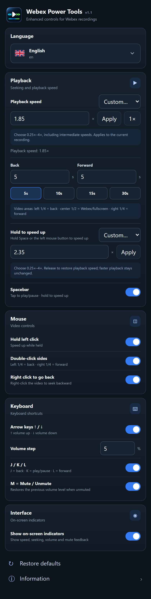

# User guide

## Open the settings

Click the extension's toolbar icon or select it from Chrome's Extensions menu on a supported HTTPS Webex page. When unpinned, a floating settings icon appears near the bottom-right corner. The toolbar action is enabled on Webex hosts even when no recording is present.

Settings save as you change them and update content scripts in open pages. Refresh recordings that were open when you installed or reloaded the extension.

This image shows the complete scrollable settings page, rendered with development fixtures.

## Playback and seeking

**Back** and **Forward** are independent durations from 1 to 120 seconds. Preset buttons set both to 5, 10, 15, or 30 seconds. Seeking stops at zero or the media duration when known.

| Video area | Double-click behavior |
| --- | --- |
| Left 25% | Seek backward |
| Center 50% | Webex handles the event; its player may toggle fullscreen |
| Right 25% | Seek forward |

When side seeking is enabled, a single side click waits 280 ms before toggling playback. A second click within that window cancels the pending toggle and seeks. Slower double-clicks can also trigger the single-click action: the delay is fixed, independent of operating-system settings. Center clicks retain Webex behavior.

After the first double-click, **every additional click on the same side** adds
another configured seek step immediately. With defaults: double-click = 5 seconds,
third click = 10 seconds total, fourth click = 15 seconds total. Each click keeps
the sequence open for another 850 ms; after that pause, start again with a double-click.
Changing sides starts a new sequence. Clicking the center/another control, starting
a speed hold, losing focus, or disabling side seeking also ends the sequence.
This works with on-screen indicators disabled and respects custom Back/Forward durations.

Right-click seeking applies anywhere over the video outside interactive controls. It replaces the usual context menu while enabled; switch it off to restore the context menu.

## Custom sustained playback speed

Open the **Playback speed** dropdown in the extension popup. Its presets match
**Hold to speed up**: 1.25×, 1.5×, 1.75×, 2×, 2.5×, 3× and 4×; it also includes
**1×**. Selecting a preset applies it immediately. Select **Custom…** to show the
numeric editor. Enter 0.25×–4×, including intermediate values such as 0.85×,
1.15× or 1.85×, then choose **Apply** or press
Enter. Values are rounded to two decimal places; **1×** restores normal speed.
This applies to media in the current Webex tab, including matching frames and
synchronized audio/video tracks. Other tabs keep their speed.

The rate remains active after closing the popup, pausing and resuming, until you
change it or Webex replaces/reloads the player. Chrome saves the last applied
custom input for reuse; it does not automatically impose it on new recordings.
The popup reads the current rate when reopened. The native Webex toolbar label
also shows the actual speed, including intermediate values and rates such as
3× outside the native preset list. It follows temporary holds and restores the
base speed on release. The native menu keeps its own preset options; use the
extension to choose custom values.

Temporary Space/mouse holds restore this selected speed afterward. A faster
base rate is preserved during the hold. Changing the rate during an active hold
changes what is restored on release. Playback remains paused if it was paused
before applying a custom rate. No new extension permission is required.

## Temporary playback speed

Choose 1.25×, 1.5×, 1.75×, 2×, 2.5×, 3×, or 4×. Select **Custom…** to enter
0.25×–4×, including intermediate values such as 1.85× or 2.35×, then choose
**Apply** or press Enter. Chrome saves this hold target independently of the
permanent playback speed. A value matching a preset selects that preset again.
The default is 2×. Hold Space or left click over the video for at least 180 ms.
Release to restore each affected element's original rate. A paused primary
player runs during the hold and pauses again afterward.

The hold rate is a minimum: a 2× hold preserves a base already at 3×. Space and mouse holds can overlap; speed restores after the final active release. Losing focus or switching away also ends the hold. Disabling a hold feature cancels that active gesture when no other hold is active.

Equal base and hold speeds stay unchanged. The hold indicator shows the actual
rate from the moment it appears: a 3× base with a 2× target displays 3×, matching
the native Webex toolbar.

A quick Space press toggles playback. Turning off **Spacebar** disables its speed hold but preserves tap-to-play/pause. Turning off **Hold left click** affects only that mouse gesture.

## Keyboard and audio

| Key | Action |
| --- | --- |
| J | Seek backward |
| K | Play/pause, including replay after completion |
| L | Seek forward |
| ↑ / ↓ | Raise / lower volume |
| M | Mute / unmute |

Shortcut groups can be disabled. Key repeat is ignored; press again for another action. Shortcuts are ignored in editable fields, focused interactive controls, text composition, and combinations with Ctrl, Alt, Shift, or Command/Meta.

Volume moves to step boundaries. With a 5% step, 42% moves up to 45% or down to 40%; 45% moves up to 50%. Volume stays within 0–100%.

The first M press saves the active media group's volume and mute flags and sets volume to zero. The next M restores those states. Pressing ↑ while muted overrides the snapshot and raises volume from zero. If media was already silent before M, the extension restores its last observed audible volume, or 100% if none was observed. Replacement elements use a best-effort restore from the prior group.

## Interface and language

**Show on-screen indicators** controls speed, seek, volume, and mute feedback. Repeated seeks in one direction accumulate when they occur within 850 ms. Indicators show the requested seek amount; actual movement can be smaller at recording boundaries.

**Automatic** follows Chrome's interface language, falling back to English for unsupported languages. Search by native/English name, code, or alias. Arabic uses RTL layout. Selection affects the popup and translated player indicators.

**Restore defaults** resets all preferences. **Information** expands the storage/privacy explanation.

## Troubleshooting

| Symptom | Check |
| --- | --- |
| Disabled toolbar icon | Use an HTTPS page on `webex.com` or its subdomains. |
| Controls do nothing after installation | Refresh the recording and check that the feature is enabled. |
| Keyboard shortcuts do nothing | Focus the player/frame, leave text fields or controls, and release modifiers. |
| Double-click also toggles playback | Try a quicker double-click; the side-click delay is 280 ms. |
| Context menu does not open | Disable **Right click to go back**. |
| Temporary speed does not start | Hold at least 180 ms. The browser/player may reject playback or rate changes. |
| Settings fail to save | Read the status message and check Chrome extension errors and sync settings. |
| Floating icon is missing | It appears only when unpinned; pin state is checked about every four seconds. |

Closed shadow roots, inaccessible media, and unmatched frames may need player-specific support. For an issue report, include extension/Chrome versions, settings, reproduction steps, and extension errors. Avoid private recording links or meeting content.
